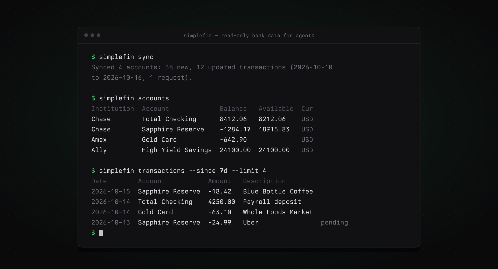

# simplefin-cli



Read-only access to your bank, card and loan accounts through [SimpleFIN Bridge](https://bridge.simplefin.org), as a CLI and an MCP server for agents.

Data is synced into a local SQLite database, and every query reads that copy. Only `sync` talks to SimpleFIN, which allows about 24 requests a day and disables access tokens that keep going over.

## Setup

1. **Install** (needs [uv](https://docs.astral.sh/uv/) and macOS for the Keychain):

   ```sh
   uv tool install git+https://github.com/R44VC0RP/simplefin-cli
   ```

2. **Connect (a human does this step).** At [bridge.simplefin.org](https://bridge.simplefin.org), connect your banks and create a setup token for a new app. Then run this in a terminal and paste the token:

   ```sh
   simplefin claim
   ```

   The token works once. The access URL it returns is saved to the macOS Keychain and never printed.

3. **Load history:**

   ```sh
   simplefin sync --days 365   # one request per 45 days of history
   simplefin accounts          # check every account shows up
   ```

4. **Add the MCP server** to your agent:

   | Agent | Config |
   |---|---|
   | OpenCode (`opencode.json`) | `"mcp": { "simplefin": { "type": "local", "command": ["simplefin", "mcp"] } }` |
   | Claude Code | `claude mcp add simplefin -- simplefin mcp` |
   | Codex (`~/.codex/config.toml`) | `[mcp_servers.simplefin]`<br>`command = "simplefin"`<br>`args = ["mcp"]` |
   | Anything else | stdio server, command `simplefin mcp` |

5. **Keep it fresh.** Run `simplefin sync` once or twice a day (cron, launchd or similar), at a random minute rather than on the hour.

## Rules for agents

- Never ask the user to paste a setup token or access URL into chat. If `status` says not connected, tell them to run `simplefin claim` themselves.
- Read with the query tools; they're free. Call `sync_now` / `simplefin sync` only when `sync_status` shows data older than about a day. Never loop on it.
- Amounts are signed strings: positive means money into the account, negative means money out. Card purchases are usually negative; check a known one before assuming.
- Show Bridge errors (from `sync_status`) to the user. They usually mean a bank needs reconnecting at bridge.simplefin.org.

## MCP tools

| Tool | What it does |
|---|---|
| `list_accounts` | Accounts with institution, balance and balance date |
| `list_transactions` | Newest first. Filters: `account` (id or part of name), `since`/`until` (`YYYY-MM-DD` or `30d`), `search`, `min_amount`/`max_amount`, `pending`, `limit` |
| `summarize_cash_flow` | Money in and out per account over a period |
| `get_balance_history` | Balance recorded at each sync |
| `sync_status` | Last sync, requests used today, Bridge errors |
| `sync_now` | Fetch from SimpleFIN. Refuses within an hour of the last sync |

## CLI

Every command accepts `--json`.

```sh
simplefin status                                 # connected? last sync, quota used
simplefin sync [--days N] [--force]              # --force skips the local 20/day budget
simplefin accounts
simplefin transactions [--account chase] [--since 30d] [--until 2026-10-01]
                       [--search uber] [--min -500] [--max -100] [--pending] [--limit 100]
simplefin summary [--since 30d] [--account chase]
simplefin balances <account> [--since 90d]
simplefin logout                                 # removes the Keychain entry
simplefin mcp                                    # MCP server over stdio
```

## Configuration

| Variable | Default | Purpose |
|---|---|---|
| `SIMPLEFIN_DB` | `~/Library/Application Support/simplefin-cli/simplefin.db` | Database location |
| `SIMPLEFIN_ACCESS_URL` | Keychain | Use this access URL instead of the Keychain (for CI or other machines; treat it as a password) |

To revoke access, run `simplefin logout` and disable the app connection at bridge.simplefin.org.
